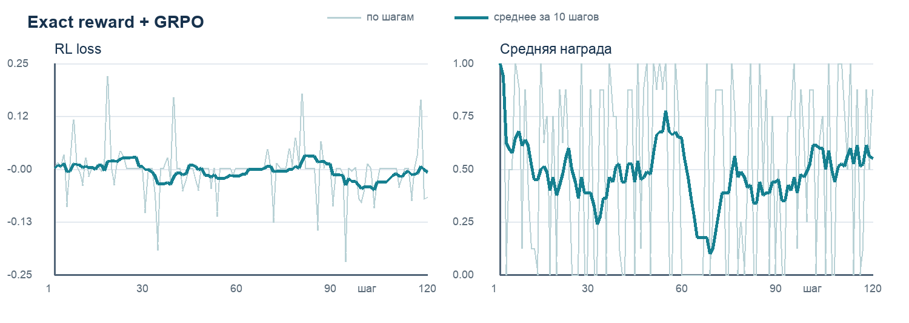
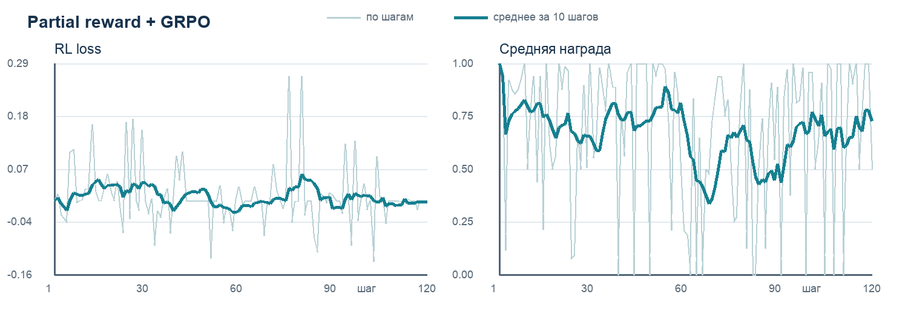
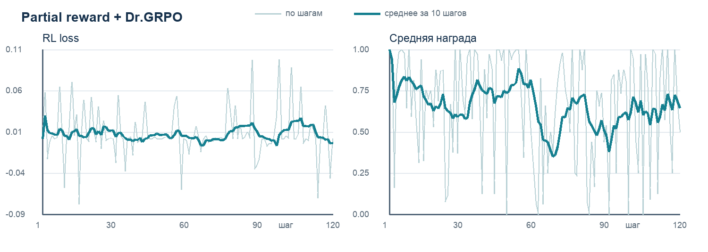

# HW5: RL для вызова функций

## Данные

- Модель: `Qwen/Qwen3.5-2B`
- Данные: `Team-ACE/ToolACE`
- Из 11.3тыс диалогов используется первый ответ ассистента
- Train / validation — 9.3тыс / 1тыс, разбиение по диалогам с seed 42

## Награда и обучение

- `exact`: 1 за совпадение всех вызовов и аргументов, иначе 0
- `partial`: `0.1 за формат + 0.4 × F1 имён функций + 0.5 × точность аргументов`
- Если вызов не нужен, верный ответ без вызова получает 1, лишний вызов — 0
- Верная функция с одним неверным аргументом: 0 в `exact`, 0.5 в `partial`
- GRPO: `A = (R − средняя R в группе) / (std(R) + δ)`; Dr.GRPO: `A = R − средняя R`
- Общие настройки: LoRA r=16, alpha=32, BF16, batch 8, 8 генераций, lr 2e-5, постоянный scheduler, beta 0.01, temperature 1.3, 120 шагов

| Запуск | Гипотеза | Награда и алгоритм | Шаг | Время, с |
|---|---|---|---:|---:|
| `rl_exact` | Полное совпадение ближе к BFCL | exact + GRPO | 120 | 1361* |
| `rl_partial` | Частичный балл даст больше сигнала | partial + GRPO | 120 | 328 |
| `rl_drgrpo` | Другая нормировка улучшит качество | partial + Dr.GRPO | 120 | 312 |

\* Первый запуск включал холодную компиляцию, после обучения сломался экспорт

## Результаты BFCL

| Запуск | Overall | Simple | Multiple | Parallel | Parallel + Multiple | Irrelevance |
|---|---:|---:|---:|---:|---:|---:|
| Base | 68.93% | 68.00% | 78.67% | 56.00% | 80.00% | 62.00% |
| `rl_exact` | **75.87%** | 72.00% | 73.33% | 64.00% | 84.00% | **86.00%** |
| `rl_partial` | 74.67% | 74.00% | **79.33%** | **68.00%** | 84.00% | 68.00% |
| `rl_drgrpo` | 73.33% | 74.00% | 78.67% | 56.00% | 84.00% | 74.00% |

- Лучший `rl_exact`: +6.93 п.п. к бейзлайну, основной выигрыш — Irrelevance, 62% → 86%
- Multiple у него снизился с 78.67% до 73.33%, поэтому общий рост не означает улучшение каждой категории
- RL loss на графиках — функция обучения, по нему нельзя судить о точности BFCL

## Ответы на вопросы

1. **Почему такие награды?** `exact` проверяет функции и аргументы, как BFCL. `partial` даёт балл и за частично верный вызов
2. **Что сильнее всего повлияло?** Dr.GRPO вместо GRPO: −1.33 п.п., смена награды: −1.20 п.п.
3. **Совпадает ли награда с BFCL?** Нет, первые / последние 20 шагов: exact 0.519 / 0.538, partial 0.746 / 0.712, Dr.GRPO 0.732 / 0.642
   Все три BFCL выше Base => награды разные
4. **Что если награды в группе равны?** Advantage равен нулю, сигнал для обучения пропадает
5. **Какие ошибки остались?** Какие-то примеры из `results/rl_exact/bfcl/predictions.jsonl`:

| ID | Ответ rl_exact | Эталон |
|---|---|---|
| simple_241 | Ответ текстом без вызова | US_President_During_Event для Гражданской войны |
| simple_150 | annual_interest_rate=3 для 3% | 0.03 |
| parallel_180 | Два вызова stock_price | Восемь вызовов для двух компаний и четырёх типов цен |
| irrelevance_113 | Лишний find_pois | Нет вызова по разметке BFCL, хотя подходящий инструмент доступен |
| parallel_multiple_2 | rectangle.calculate_perimeter | circle.calculate_circumference |

