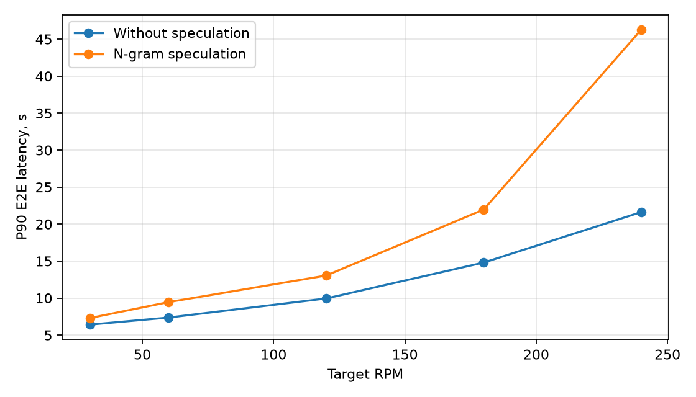
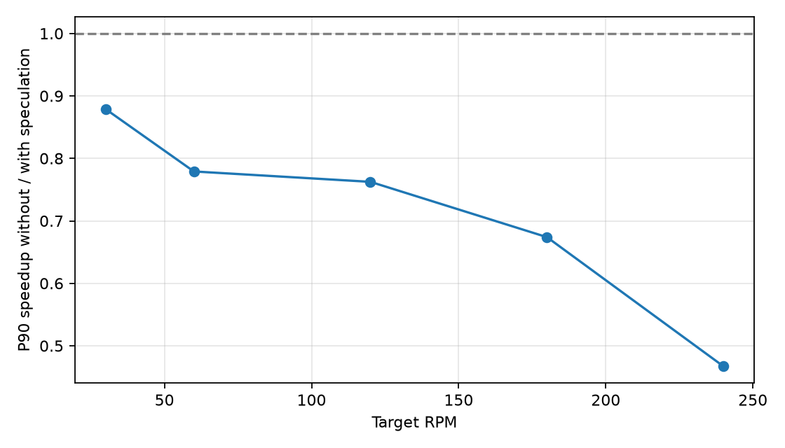
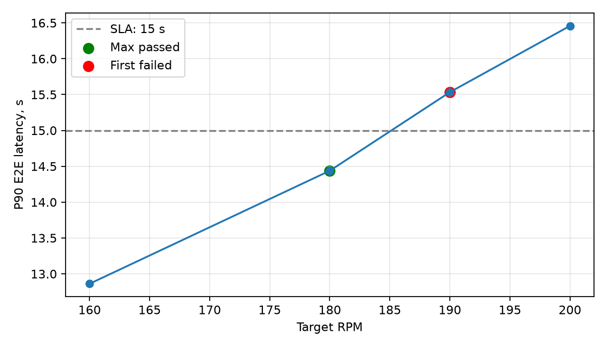

# HW6: инференс Qwen3-8B

## Методика

- Одна A100 80 GB, GPU 0, vLLM 0.22.0 и AIPerf 0.13.0
- Модель `Qwen/Qwen3-8B`, reasoning выключен, температура 0, seed 42, максимум 512 токенов
- `data/requests.jsonl`: 640 исходных запросов
- Перед каждым замером и после него сбрасывается кэш

В бейзлайне средний TTFT равен 0.12 с, а полная latency — 6.89 с

## 120 RPM

| Конфигурация | Параметры vLLM | Mean, с | P90, с | S |
| --- | --- | ---: | ---: | ---: |
| baseline | по умолчанию | 6.893 | 9.709 | 1.000 |
| chunk4096 | `max_num_batched_tokens=4096` | 6.817 | 9.652 | 1.011 |
| chunk4096, повтор | те же настройки | 6.850 | 9.678 | 1.006 |
| chunk4096, ещё один повтор | те же настройки | 6.851 | 9.649 | 1.006 |
| chunk8192 | `max_num_batched_tokens=8192` | 6.873 | 9.654 | 1.003 |
| seq32_chunk8192 | `max_num_seqs=32`, чанк 8192 | 6.868 | 9.641 | 1.004 |
| eager | `enforce_eager` | 9.229 | 11.877 | 0.747 |
| spec_ngram_gpu | чанк 4096, `ngram_gpu`, 4 токена | 8.269 | 12.410 | 0.834 |

, здесь `S = Mean baseline / Mean конфигурации`

Выводы:
- Чанк 4096 оказался лучшим среди обычных конфигураций, но повтор дал лишь 0.6% к бейзлайну — разница мала
- Лимит 32 последовательности почти не изменил задержку, пик одновременных запросов у бейзлайна — 22
- Для `enforce_eager` средняя latency выросла на 34%
- При 120 RPM `ngram_gpu` замедлил mean на 21% относительно повторного запуска той же конфигурации без спекдека

## Спекулятивное декодирование

- Использован `ngram_gpu` (вторая модель не нужна)
- Размер черновика — 4 токена, длина совпадения — от 2 до 5 токенов

| RPM | P90 без спекдека, с | P90 со спекдеком, с | Ускорение P90 |
| ---: | ---: | ---: | ---: |
| 30 | 6.417 | 7.301 | 0.879 |
| 60 | 7.371 | 9.461 | 0.779 |
| 120 | 9.951 | 13.051 | 0.762 |
| 180 | 14.804 | 21.966 | 0.674 |
| 240 | 21.621 | 46.285 | 0.467 |

, здесь Ускорение `P90 = задержка без спекдека / задержка со спекдеком`

Выводы:
- На 30–240 RPM спекдек везде медленнее
- При росте нагрузки разрыв увеличивается
- Точка перехода от выигрыша к проигрышу не наблюдается

## Нагрузочный тест

- Каждая эксперимент держит заданный RPM 300 секунд
- Условие прохождения: P90 полной `latency < 15с` (и нет ошибок)

| Задано, RPM | Получено ответов | Фактически, RPM | Mean, с | P90, с | Ошибки | SLA |
| ---: | ---: | ---: | ---: | ---: | ---: | --- |
| 160 | 800 | 156.02 | 8.982 | 12.862 | 0 | да |
| 180 | 899 | 174.99 | 10.112 | 14.438 | 0 | да |
| 190 | 949 | 185.45 | 10.719 | 15.534 | 0 | нет |
| 200 | 999 | 194.57 | 11.165 | 16.458 | 0 | нет |

- Максимальная проверенная нагрузка по SLA — 180 RPM, P90 14.438 с
- При 190 RPM P90 уже 15.534 с, граница лежит между этими точками

